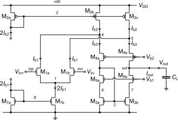

# Design of the Folded-cascode OTA

This notebook presents the analysis, design and simulation of the folded-cascode OTA shown above.

The ngspice simulations are using the EKV 2.6 compact model with the parameters corresponding to a generic 180nm bulk CMOS process. For the simulations to work you should install ngspice following the .

